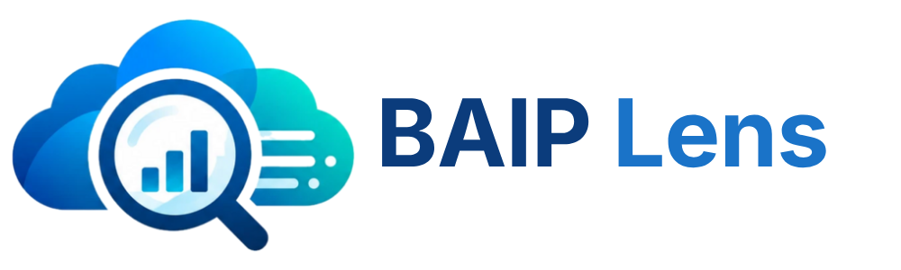
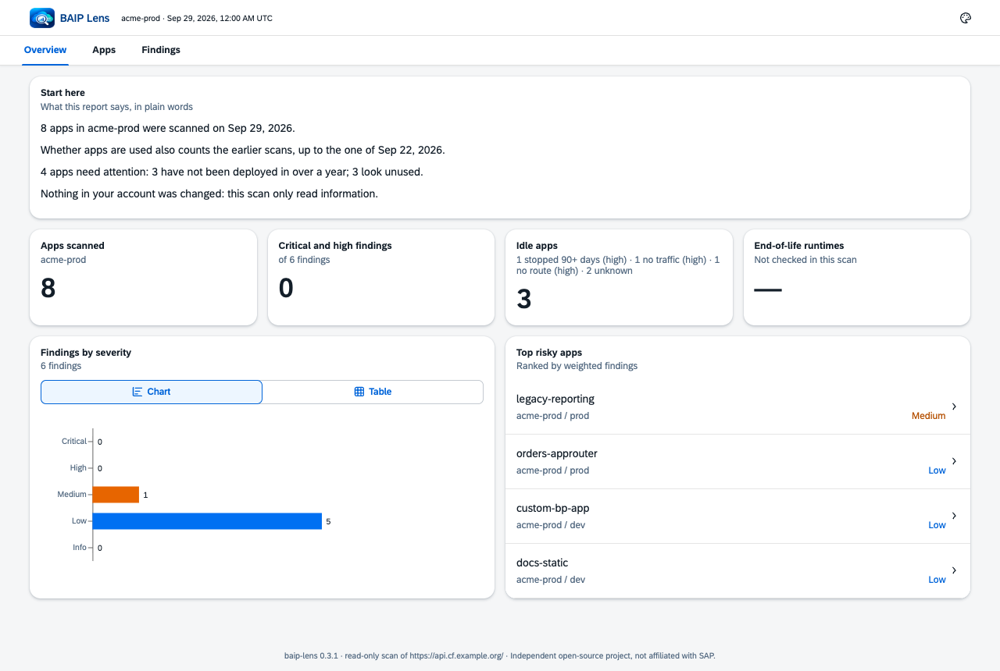
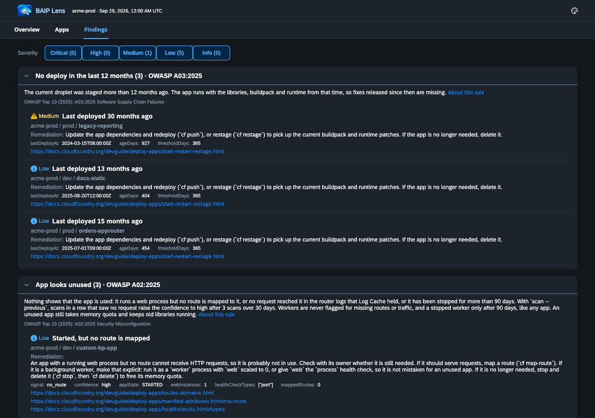
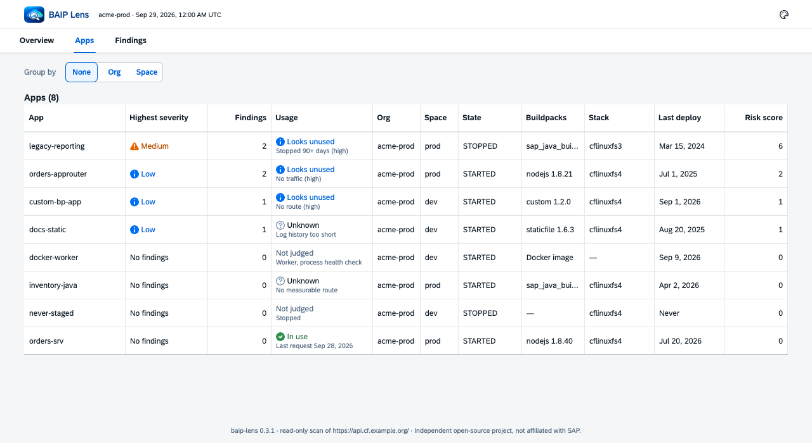

<p align="center">
  <picture>
    <source media="(prefers-color-scheme: dark)" srcset="docs/assets/logo-dark.png">
    
  </picture>
</p>

# BAIP Lens

**A read-only health and security scanner for Cloud Foundry landscapes on SAP BTP.** Open source under Apache-2.0, free for everyone, built in public, and it runs on your machine.

Point BAIP Lens at a Cloud Foundry org. With nothing more than the **Space Auditor** role, it inventories every app, flags stale deployments, and writes an **offline HTML report** plus JSON, CSV and SARIF. Checks for end-of-life runtimes, outdated buildpacks and libraries, known vulnerabilities and risky configuration follow in the next releases.

It sends only `GET` requests to the Cloud Foundry API. It contacts no third party except for public version and vulnerability lookups, and it never writes user names, tokens or secret values into its output.

[](https://github.com/sebastianomarchesini/BAIP-Lens/actions/workflows/ci.yml)
[](https://github.com/sebastianomarchesini/BAIP-Lens/actions/workflows/security.yml)
[](LICENSE)
<!-- Add once the Scorecard workflow has run on main:
[](https://scorecard.dev/viewer/?uri=github.com/sebastianomarchesini/BAIP-Lens)
-->

> **Status: 0.3.1.** This patch release updates zod for a security advisory and fixes the logo and the description on the npm page. Release 0.3.0 added the `APP_IDLE` rule: apps that nothing seems to use, because they are started with no route, no request reached them in the router logs that Log Cache holds (confirmed across scans with `scan --previous`), or they have been stopped for more than 90 days. Guided mode asks for the region as text, and `baip-lens regions` lists the regions. They join the Cloud Foundry scan with guided mode, the app inventory, the `APP_NO_RECENT_DEPLOY` rule, the local scan of a CAP or MTA project against thirteen OWASP-tagged rules (`baip-lens project --path <dir>`, no login and no network), all report formats and the HTML report. The npm package is `baip-lens`; the former `btp-lens` is deprecated. The other rules are planned in [docs/rules.md](docs/rules.md) and the [roadmap](docs/roadmap.md). Feedback from real landscapes is very welcome in the issues.
>
> This release is aimed at **developers and platform teams**. Guided mode and the no-terminal guide were written for non-developers but have not yet been tested with them in usability sessions; those sessions are still to come (see the [roadmap](docs/roadmap.md)). If you are not a developer and try it anyway, every hesitation you report is a contribution.



## Try it in five minutes (guided mode)

You need [Node.js](https://nodejs.org) (the LTS installer, next-next-finish) and a BTP login with the **Space Auditor** role, which is read-only. You do not need the cf CLI.

```sh
npx baip-lens
```

Guided mode asks four questions: where your landscape is (type your region, for example `eu10` or `us10-001`, or paste the API endpoint from the cockpit; `list` shows all regions), how to sign in (your browser opens your company login and shows a one-time code), which org, and whether to start. The report then opens in your browser. Never used a terminal? Follow the [step-by-step guide with screenshots](docs/getting-started-no-terminal.md). Something not working? `npx baip-lens doctor` checks Node.js, network, certificates, login and the output folder and tells you what to do in one sentence each.

## Quickstart for developers and CI

```sh
cf login -a https://api.cf.eu10.hana.ondemand.com      # any user with Space Auditor
npx baip-lens scan --api https://api.cf.eu10.hana.ondemand.com --org my-org
open reports/baip-lens-report.html                      # works offline
```

### Project scan (no login needed)

```sh
npx baip-lens project --path ./my-cap-project      # reads the project files; asks OSV.dev about its public npm packages
```

This checks a local CAP or MTA project the way a reviewer would: effective `cds` configuration per profile, `mta.yaml`, `xs-security.json`, `xs-app.json`, the CDS model, seed CSV files and the SAPUI5 bootstrap, and writes the same reports with a `file:line` location per finding (also in SARIF, for code scanning). The rules follow the OWASP Top 10 (2025) patterns of the public SAP TechEd 2026 workshop XP261; see [docs/rules.md](docs/rules.md#project-rules).

It also reads the npm lockfiles of the project and reports every package version with a **known vulnerability** (`DEP_KNOWN_CVE`). For that it sends the names and versions of the packages that come from the public npm registry, and nothing else, to [OSV.dev](https://osv.dev), and says so first. `--no-dependency-check` turns the lookup off, and `--dependency-exclude '@acme/*'` holds packages back; see [docs/privacy.md](docs/privacy.md#what-is-sent-to-osvdev).

### Project scan of a deployed app or project

```sh
cf login --sso                                     # once; target the org and space of your app
npx baip-lens project --cf                         # lists the projects and apps there, you pick one
```

The same project rules, run on what is actually deployed: BAIP Lens reads the app's files live from a running instance over the platform's SSH proxy (the SFTP file channel only, read requests only), nothing is downloaded or changed, and only the reports are written. It needs the **Space Developer** role in the space and SSH turned on for the app; the command says so before it starts, checks your role first, and shows the `cf` command to run for an app it cannot read. Cloud Foundry records every session as an `audit.app.ssh-authorized` event. A deployed CAP service usually ships its compiled model instead of the `.cds` sources, so the CDS-model rules find less there than with `--path` (see [docs/data-sources.md §10](docs/data-sources.md#10-deployed-apps-baip-lens-project---cf)).

The list groups the apps by the project (MTA) they were deployed from. Choosing a project reads all its apps (approuter, service, deployer), one read-only session per app, one after the other, into **one report**; an app that cannot be read (stopped, SSH off, no project files) is named in the report as not read, and the others are still read ([docs/data-sources.md §11](docs/data-sources.md#11-deployed-mta-projects-project---cf-picker)). In scripts, name one app with `--app <name>` or a whole project with `--mta <id>`.

To run the latest development version from source (Node.js 22.12 or later):

```sh
git clone https://github.com/sebastianomarchesini/BAIP-Lens.git && cd BAIP-Lens
npm ci && npm run build
node packages/cli/dist/cli.js                          # guided mode
node packages/cli/dist/cli.js scan --api https://api.cf.eu10.hana.ondemand.com --org my-org
```

### Credentials

BAIP Lens uses the first of these that is set:

1. `BAIP_LENS_ACCESS_TOKEN`, for example `BAIP_LENS_ACCESS_TOKEN="$(cf oauth-token)"`.
2. `BAIP_LENS_CLIENT_ID` and `BAIP_LENS_CLIENT_SECRET`, for an OAuth client with a CF role.
3. Your cf CLI session (`~/.cf/config.json`, or `$CF_HOME/.cf/config.json`). It must target the same API as `--api`. An expired token is refreshed in memory only, and the file is never written.

Behind a corporate proxy, set `HTTPS_PROXY` and `NODE_USE_ENV_PROXY=1` so that Node.js routes requests through it. That variable exists from Node.js 22.21 and 24.0; older versions ignore it, and `baip-lens doctor` says so.

## Commands

```text
baip-lens                       guided mode (four questions, report opens in the browser)
baip-lens guided [--no-open]    the same, explicitly
baip-lens doctor [--api <url>]  checks Node.js, network, certificates, login and output folder
baip-lens regions               lists the regions you can type instead of an API endpoint
baip-lens scan   --api <cf api url> --org <name> [--space <name>] [--deep]
                [--out ./reports] [--format html,json,csv,sarif] [--fail-on <severity>] [--concurrency 5]
                [--no-traffic-check] [--min-traffic-window 12] [--traffic-pages 5]
                [--previous <snapshot.json>] [--quiet]
baip-lens project --path <dir> [--no-dependency-check] [--dependency-exclude <list>]
                [--out ./reports] [--format html,json,csv,sarif] [--fail-on <severity>] [--quiet]
baip-lens project --cf [--app <name> | --mta <id> [--mta-namespace <name>]]
                [--api <url>] [--org <name>] [--space <name>]
                [--no-dependency-check] [--dependency-exclude <list>]
                [--out ./reports] [--format html,json,csv,sarif] [--fail-on <severity>] [--quiet]
baip-lens report --from <snapshot.json> [--format html,json,csv,sarif] [--out ./reports] [--fail-on <severity>]
baip-lens version
```

- With no arguments on a terminal, guided mode starts; in a script it prints usage and exits 2.
- `--api` takes the API endpoint or just the region: `--api eu10` is `https://api.cf.eu10.hana.ondemand.com`. `baip-lens regions` lists the regions.
- `project` scans a local CAP or MTA project folder for the thirteen configuration and model rules in [docs/rules.md](docs/rules.md#project-rules) (mocked authentication in production, unrestricted services, missing audit logging, open approuter routes, seed data with card numbers, and more), each tagged with its OWASP Top 10 (2025) category. It reads files only: no login, no child process, and it never opens `.env`, `.cdsrc-private.json`, `default-env.json`, `.npmrc`, keys or `*.mtaext` files.
- `project` also reads the npm lockfiles (`package-lock.json`, `npm-shrinkwrap.json`) and looks the packages that were resolved from the public npm registry up on OSV.dev for known vulnerabilities: only their names and versions are sent, each once, and the terminal says so before the first request. Every other package (a company registry, git, a local folder) is counted and never named or sent. `--no-dependency-check` makes no request about a package; the report then says that the packages were not looked up. `--dependency-exclude <list>` takes comma-separated package names or patterns such as `@acme/*` that are never looked up and never kept from a lockfile. When OSV.dev cannot be reached, the scan still finishes, and the report says what was not checked. See [docs/rules.md](docs/rules.md#dependency-rules).
- `project --cf` runs the same rules on what is deployed instead of a folder: it takes the API, login, org and space from the cf CLI (`--api`, `--org` and `--space` override them), lists the apps of the space grouped by the project (MTA) they were deployed from, and reads what you pick over SSH with read-only SFTP: one app (or name it with `--app`), or every app of a project (or name it with `--mta <id>`), one session per app and at most 50 apps. `--mta-namespace <name>` tells two deployments of one project apart (`""` is the one without a namespace). It needs Space Developer and SSH enabled for each app, and records one audit event per app in Cloud Foundry.
- Guided mode signs in the way `cf login --sso` does (one-time code from your company login) or with username and password, keeps the session in memory only, and writes to `./baip-lens-reports/<date-time>/`.
- `scan` and `project` write one snapshot (`snapshot-<time>.json`) and the requested reports.
- `report --from` re-runs every rule on a snapshot **offline**, for example after you upgrade BAIP Lens.
- `scan --previous <snapshot.json>` passes the last snapshot of the same org to the next scan, so `APP_IDLE` counts scans in a row without a request ("No requests seen across 6 scans over 42 days"). Three or more over 30 days or more raise its confidence to high. Each snapshot carries the history on, so the last one is all the next scan needs, even when it was a `--space` scan: the history of apps a scan did not see is kept as it was.
- Exit codes:
  - `0`: no findings at or above `--fail-on` (the default, `none`, never fails).
  - `1`: findings met the threshold.
  - `2`: tool error.

The HTML report is a single file. Fonts, themes and data are embedded, it follows your light or dark system setting, and it works at phone width. It carries a Content Security Policy with `connect-src 'none'`, so the browser itself refuses to let it connect anywhere, and only the scripts bundled at build time may run. The CSV output is UTF-8 with a byte-order mark, so Excel shows non-ASCII names correctly, and it neutralizes spreadsheet formulas (a name starting with `=`, `+`, `-` or `@` gets a leading apostrophe). The SARIF output (2.1.0) is ready for code-scanning tools. Report folders and files are created readable by you only.

## Permissions

| Check | Minimum CF role | Default |
| --- | --- | --- |
| App inventory and current droplets (`collect.apps`, `collect.droplets`), rule `APP_NO_RECENT_DEPLOY` | Space Auditor | on |
| Routes and web processes (`collect.routes`, `collect.processes`), rule `APP_IDLE` | Space Auditor | on |
| Last request per app from Log Cache (`collect.traffic`), for `APP_IDLE` | Space Auditor | on; `--no-traffic-check` turns it off |
| Planned: buildpacks, stacks, binding metadata and the rules built on them | Space Auditor | on, in the next releases |
| Planned: plain-text secrets in environment variable **names** (`ENV_SECRET_PLAINTEXT`) | Space Developer or Space Supporter | `--deep` only |
| Project scan (`collect.project` and the thirteen project rules) | none: local files, no login, no network | on, for `baip-lens project` |
| Known vulnerabilities of a project's npm packages (`collect.dependencies`, `collect.osv`, rule `DEP_KNOWN_CVE`) | none for the lookup: OSV.dev is public and gets no credential (reading a deployed app's lockfile with `--cf` needs Space Developer, like the rest of that scan) | on, for `baip-lens project`; `--no-dependency-check` turns the lookup off |

The Cloud Foundry list endpoints answer with what your user may see rather than with 403, so a user who can see the org but none of its spaces gets a clear message and exit code 2 instead of an empty report. When a call does return 403, the check is recorded as *skipped: insufficient role* and the scan continues. Details are in [docs/permissions.md](docs/permissions.md).

## Privacy

- **Read-only:** the HTTP client refuses any method other than `GET` to the CF API and its log cache. The only `POST` request goes to the OAuth token endpoint.
- **No data leaves your machine:** a Cloud Foundry scan talks to your CF API, its login server (UAA) and its log cache, and to nothing else. The log cache address comes from your CF API, and `--no-traffic-check` leaves it out. A project scan sends one thing: the names and versions of the project's **public** npm packages, to `api.osv.dev` to learn their known vulnerabilities and (in progress: looked up, not reported yet) to `registry.npmjs.org` to learn whether they are deprecated. It says so before the first request, `--no-dependency-check` turns it off, and `--dependency-exclude` holds packages back ([docs/privacy.md](docs/privacy.md#what-is-sent-to-osvdev)). The egress allow-list also names `endoflife.date` and `ui5.sap.com` for the version rules of the next releases; neither is contacted yet. There is no telemetry.
- **No personal data:** user names, emails and IDs are never written. Audit-event actors are dropped when the events are read.
- **No secrets:** tokens, environment variable values and service credentials are never printed or stored. Credentials in buildpack URLs are stripped, everything printed to the terminal passes through a redaction filter, and the endpoints that return credentials (`/v3/apps/:guid/env`, binding `details`) are refused by the allow-list even for `GET`.

See [docs/privacy.md](docs/privacy.md), [docs/faq.md](docs/faq.md), [docs/data-sources.md](docs/data-sources.md) and the [security review](docs/security-review.md).

Evaluating BAIP Lens for your company? [docs/due-diligence.md](docs/due-diligence.md) answers the questions that managers and security, legal and procurement teams ask before a first run, each with the code, test or document behind it.

## Sample report

| Findings (dark theme) | Apps |
| --- | --- |
|  |  |

These screenshots use the synthetic `acme-prod` fixture landscape. Run `npm run sample` to generate the same report in `reports/sample/`.

## Development

```sh
npm ci
npm run build        # UI single-file template, then the CLI
npm test             # unit and fixture tests (no live calls)
npm run lint && npm run typecheck && npm run format:check
npm run sample       # sample reports from the fixture snapshot
npm run e2e          # opens the HTML report with networking disabled (Playwright)
```

The repository is an npm workspaces monorepo:
- `packages/cli` holds the `baip-lens` CLI.
- `packages/ui` holds the React and UI5 Web Components report.
- `docs/` holds the verified data sources, rules, permissions and privacy notes.

## Contributing and community

BAIP Lens is built in public. The [roadmap](docs/roadmap.md) and [governance](docs/governance.md) are in the repository, rules can be proposed by anyone with the "Rule proposal" issue template, and [CONTRIBUTING.md](CONTRIBUTING.md) has a 15-minute first contribution and the recipe for adding a rule. Non-developers are welcome: testing guided mode, answering questions in the issues and improving the docs count as much as code. Please read the [Code of Conduct](CODE_OF_CONDUCT.md). Contributions need a signed [Contributor License Agreement](docs/CLA.md). To report a vulnerability, see [SECURITY.md](SECURITY.md).

## Support the project

BAIP Lens is free and will stay free. If it saved you an afternoon of clicking, consider [sponsoring](https://github.com/sponsors/sebastianomarchesini). The first goal is a code-signing certificate, so that administrators can run a downloadable executable without warnings. Sponsors are listed in [SPONSORS.md](SPONSORS.md); sponsorship never influences what the tool reports.

## Not affiliated with SAP

BAIP Lens is an independent open-source project. It is **not affiliated with, endorsed by or sponsored by SAP SE** or its affiliates. "SAP", "SAP BTP", "SAP Business AI Platform", "SAPUI5" and "Fiori" are trademarks of SAP SE, used here only to describe compatibility. The name refers to the SAP Business AI Platform (BAIP), the umbrella SAP announced in 2026 for SAP BTP, which this tool scans. The project was called BTP Lens until November 2026; the old `btp-lens` npm package is deprecated and snapshots it wrote still open with `baip-lens report --from`. The report uses the open-source UI5 Web Components (Apache-2.0) for its look and feel, and carries no SAP logo.

## License

[Apache-2.0](LICENSE). Third-party notices are in [NOTICE](NOTICE), and every HTML report embeds the licenses of the software it bundles.
